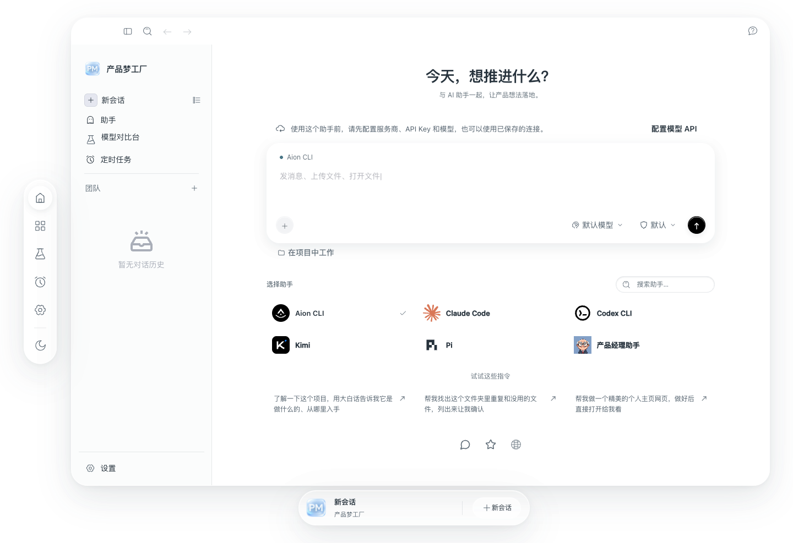
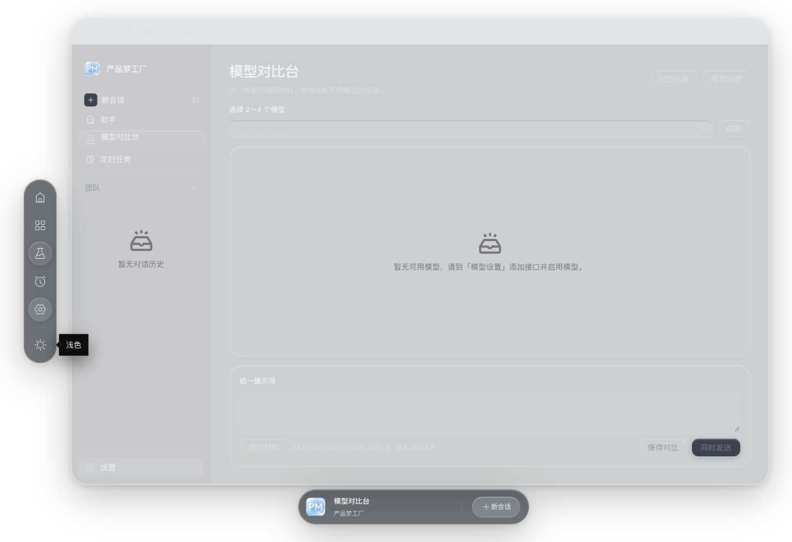

<p align="center">
  
</p>

# 产品梦工厂

把想法、项目资料和 AI 协作放在同一个桌面工作台里。

## 能做什么

- **AI 对话与项目协作**：选择已配置的助手，在对话中使用本地项目文件夹，围绕真实文件推进工作。
- **团队工作区**：组合多个助手，按项目组织协作；连接或配置缺失时提供引导。
- **模型对比**：用同一份提示词和材料同时比较 2～4 个模型，分别查看流式回答，并可停止、重试或保存结果。
- **编辑与回看**：发送失败时保留输入和附件；文件修改可先对照原文与草稿，再决定保存或还原。

## 效果展示

<p align="center">
  
</p>

<p align="center"><sub>首页 · 浅色界面</sub></p>

<p align="center">
  
</p>

<p align="center"><sub>模型对比台 · 未配置模型时的界面</sub></p>

截图来自本地演示环境；实际可用的助手和模型取决于你的配置。

## 构建与使用

当前提供源码。macOS Apple Silicon 构建需要 Node.js 22–24、Bun、Xcode Command Line Tools，以及由 `AionCore/rust-toolchain.toml` 指定的 Rust 工具链；安装依赖和准备运行资源时需要网络。

```bash
git clone https://github.com/MN0709/product-dream-factory.git
cd product-dream-factory
bash build-macos.sh
```

构建完成后，安装包位于 `AionUi/out/`。首次打开应用，在设置中添加模型接口、密钥和模型列表，然后选择助手开始对话；如需使用模型对比台，先配置至少两个可用模型。详细步骤见[模型对比台指南](AionUi/docs/guides/model-bench.zh-CN.md)。

`AionUi/` 是桌面端，`AionCore/` 是后端；两者需要保持同级目录。源码不包含个人密钥、会话或模型额度，也不包含 PDF 专用内置技能。模型请求可能由你配置的服务商计费；点击重试会产生新的请求。

## 许可

代码按各文件适用的许可分发，详见 [LICENSE](LICENSE) 与 [NOTICE](NOTICE)。
